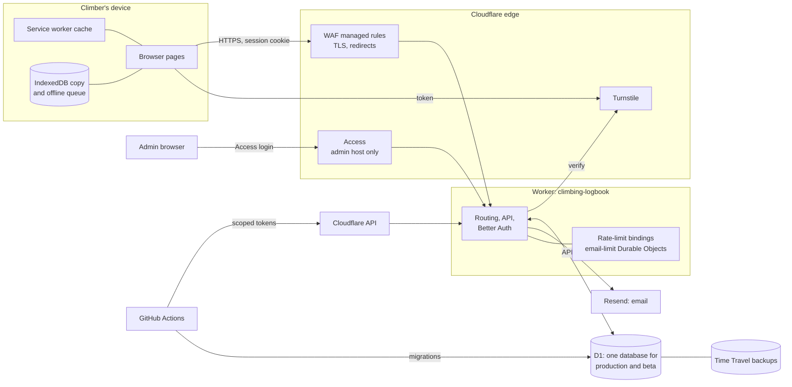

# Threat model

What Climbing Logbook protects, where its trust boundaries are, who might attack it, and what stops them. Each threat maps to a control in the code or to an open issue. Part of #829; the security verification baseline (#1034), DAST (#1036), load (#1065) and chaos testing (#1066) work from it.

**Keep it current.** Update this file in the same PR as any change that adds or moves a trust boundary: a new host, auth or session change, a new kind of data exposed to anyone but its owner, a new processor, a new secret or CI permission, or an ADR that touches any of these. `docs/coding-standards.md` says the same.

## The system

## Trust boundaries

| # | Boundary | What crosses it | Main controls |
|---|---|---|---|
| TB1 | Internet to edge | Every request | TLS, HSTS and TLS hardening (`infra/tls-hardening.tf`); WAF managed ruleset (`infra/waf.tf`, #529) |
| TB2 | Edge to Worker, anonymous | Apex pages, `/help`, login, sign-up, public profiles | Turnstile on sign-up, reset and resend; rate limits; public responses never carry health data, Exertion or moves (`server/api/public-data.js`, tested) |
| TB3 | Anonymous to signed in | The session cookie, scoped to `climbinglogbook.com` so it's shared by apex, `my.` and `beta.` | Better Auth sessions; `SameSite` cookies; origin checks on auth writes; suspended accounts can't start a session |
| TB4 | Signed in to owner | Every `/-/api/*` read and write | Per-user `WHERE user_id = ?` on every query; triggers stop rows referencing another user's place or location; authorisation matrix (`test/authorization-matrix.test.js`, #1070) |
| TB5 | Production and beta | One shared D1 database (ADR-0020) | Migrations are backward-compatible and deploy straight to production (`docs/versioning.md`); beta enrolment is per user (ADR-0029) |
| TB6 | Owner to administrator | The admin host's user list, logbook view, suspend, ban, delete | Cloudflare Access, one allowed email (`infra/access.tf`); the Worker verifies the Access token (`ACCESS_AUD`); read-only logbook view; audit log (ADR-0034) |
| TB7 | Device storage | The on-device logbook copy and the offline queue | Keyed per user (`client/user-storage.js`); *Clear device data*; logout keeps unsynced changes by design |
| TB8 | Worker to processors | Email address and username to Resend; everything to Cloudflare | DPAs and transfer safeguards (`docs/data-protection.md`); allowlist logger, no bodies or notes in logs (#1027) |
| TB9 | CI to production | Deploy, migrations, Terraform, release tags | Scoped, expiring Cloudflare tokens (`docs/infra-architecture.md`); environment secrets for deploy and infra; pinned actions, zizmor, CodeQL, Scorecard, dependency review |

## Assets

| Asset | Why it matters |
|---|---|
| Credentials and sessions | Full access to an account |
| Health information | Special category data ([dpia.md](dpia.md)) |
| Logbook data (climbs, places, notes) | Personal, often private; notes can hold anything |
| Email addresses | Personal data; harvesting and spam |
| The admin host | Can read every logbook and suspend, ban or delete accounts |
| Secrets and CI tokens | `BETTER_AUTH_SECRET` forges sessions; Cloudflare tokens deploy code or change DNS |
| Email reputation and quota | Losing them stops verification and password reset |
| Availability and the free-plan quotas | Workers, D1 and Resend limits; exhausting them is an outage |

## Actors

| Actor | Wants |
|---|---|
| Anonymous scraper | Public logbooks in bulk, email addresses, usernames |
| Credential stuffer | Accounts, using passwords leaked elsewhere |
| Spam or abuse account | Offensive public content, email sending, quota |
| Curious or malicious signed-in user | Another user's private logbook or health data |
| Botnet | Downtime, or quota exhaustion |
| Compromised dependency or Action | Code running in the Worker, the browser or CI |
| Compromised maintainer account (GitHub, Cloudflare, Resend) | Everything |
| Someone holding a climber's device | The on-device copy |

## Threats (STRIDE)

S spoofing, T tampering, R repudiation, I information disclosure, D denial of service, E elevation of privilege.

| # | | Threat | Controls in place | Gap or issue |
|---|---|---|---|---|
| 1 | S | Credential stuffing against sign-in | Per-connection and per-account sign-in limits (`server/lib/auth-rate-limit.js`, #1049); hashed passwords; optional two-step sign-in with authenticator codes, lockout after failed codes (#1436) | No breached-password check, no Turnstile on sign-in: #1055. Passkeys: #1439 |
| 2 | S | Session theft (XSS, a stolen device) | `HttpOnly` cookies; escaped rendering (`escapeHtml`, `textContent`); CSP | CSP is still report-only until the soak ends: #1042. No "sign out everywhere": #1055 |
| 3 | S | Account takeover by password reset or email change | Reset and change-of-email links by email; limits per address; Turnstile on reset | No alert email on password change: #1055 |
| 4 | S | Forged admin access | Access in front of the admin host; the Worker checks the Access token's audience and refuses all when `ACCESS_AUD` is empty | — |
| 5 | T | Writing to another user's data | Ownership checks on every write; DB triggers on cross-user references; authorisation matrix | — |
| 6 | T | Malicious or malformed import or sync payloads | Valibot schemas (`shared/entry-schema.js`); account limits (#1045); CSV formula-injection escaping on export | — |
| 7 | T | Tampering with the offline queue on a device | The server validates every replayed write as if it were new | — |
| 8 | T | A compromised dependency or Action | Pinned Actions, zizmor, Dependabot, dependency review (fails high or critical, denies copyleft), `minimumReleaseAge` | Branch rules and protected deploy environment: #1069 |
| 9 | R | Denying an admin action | `admin_audit_log` records views, suspensions, bans and deletions | Security event logging for user-side events: #1061 |
| 10 | I | Another user reading a private logbook or health data | Per-user queries; public responses tested to exclude health data; private profiles 404 like missing ones | — |
| 11 | I | Enumerating accounts | Generic sign-up and reset replies; email limits count every address alike | — |
| 12 | I | Personal data in logs, alerts or error pages | Allowlist logger; error responses carry a reference, not details; support alerts carry no personal data | — |
| 13 | I | The on-device copy on a shared or lost device | Per-user keys; *Clear device data* | Accepted in the DPIA (risk 3) |
| 14 | I | A database copy leaking (backup, CI, processor) | Processor DPA; no production data in CI or previews (separate preview database, seeded with fakes) | Off-platform backups must be encrypted: #1068 |
| 15 | I | Secrets leaking | Worker secrets set by hand, never in the repo; `.dev.vars` gitignored; leaked-secret playbook; the auth secret rotates in versions, with two-step data re-encrypted before the old one goes (#1440) | Rotation rehearsal: #1067 |
| 16 | D | Request floods | Edge DDoS protection; WAF; Worker rate limits on auth and writes | Load test: #1065 |
| 17 | D | Quota exhaustion (D1 rows, email sends) | Account limits (#1045); per-address email limits; invite gate on sign-up | Sign-up abuse controls when the gate comes off: #1057 |
| 18 | D | A bad deploy or migration | Tests, previews, backward-compatible migrations, read-only mode (#1063), rollback playbook | Game days: #1067 |
| 19 | E | A user reaching admin functions | Admin routes only on the admin host, behind Access; nothing in the app links to it | — |
| 20 | E | Beta enrolment or invite bypass | Enrolment checked per request (ADR-0016, ADR-0029); invite codes claimed before sign-up | — |
| 21 | E | A compromised maintainer account | Cloudflare tokens scoped and expiring; Access limited to one email | Account hardening (2FA everywhere, branch rules, CAA): #1069 |
| 22 | S | Switching off someone's two-step sign-in through recovery | Recovery needs the correct password first, then the link from the account's email; switching off waits 7 days, with an email when the wait starts and a cancel link; no admin reset, so no one can be talked into it (`server/lib/two-step-recovery.js`) | — |

## Known gaps, in one place

#1042 (CSP enforcement), #1055 and #1436 (account security), #1057 (sign-up abuse), #1061 (security event logging), #1065 (load), #1067 (game days), #1068 (encrypted off-platform backups), #1069 (platform account hardening). The verification baseline (#1034) and DAST (#1036) test this model.
